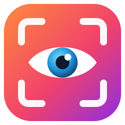
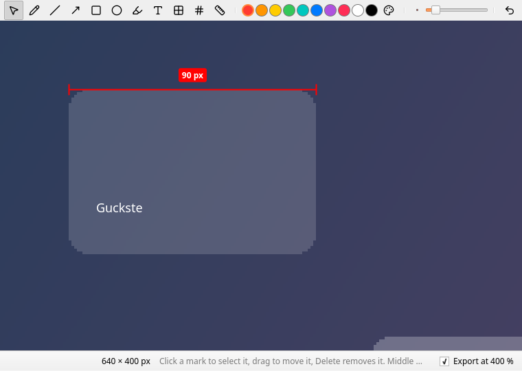

<p align="center">
  
</p>

<h1 align="center">Guckste</h1>

A screenshot and screen recording tool for the tray, written with Qt
Quick. It works like flameshot: a click on the tray icon or `guckste gui`
freezes the screen, you drag out a region, draw on it, and copy or save it.
On top of that it has an editor that enlarges a screenshot pixel for pixel,
to draw on it at that size and to put measurement marks on it that count
the pixels. The same region picker starts a recording of that region.



## Download

Every night with new commits, the
[nightly release](https://github.com/iam-peter/guckste/releases/tag/nightly)
is rebuilt for Linux (an AppImage), Windows and macOS. The macOS app isn't
signed: open it with a right click and Open the first time, and allow it to
record the screen when macOS asks.

On Debian and Ubuntu, Guckste can come from its APT repository instead,
which brings its own Qt:

```bash
sudo curl -fsSLo /usr/share/keyrings/guckste-archive-keyring.asc https://iam-peter.github.io/guckste/key.asc
echo "deb [signed-by=/usr/share/keyrings/guckste-archive-keyring.asc] https://iam-peter.github.io/guckste/apt stable main" | sudo tee /etc/apt/sources.list.d/guckste.list
sudo apt update && sudo apt install guckste
```

Put `nightly` in place of `stable` for the nightly builds.

## Using it

`guckste` starts in the tray. The tray menu takes a screenshot, captures
all screens at once, opens an image in the editor, records the screen,
switches launching at login on and off, and opens the settings. There is
one Guckste per user: it holds a lock file, and started again, `guckste`
hands its command to the running instance and quits (`guckste --replace`
quits the running one and takes its place, for a new build):

- `guckste gui` — pick a region. Bind it to Print in your desktop's
  keyboard settings (XFCE: Settings → Keyboard → Application Shortcuts;
  GNOME: Settings → Keyboard → Custom Shortcuts; KDE: System Settings →
  Shortcuts).
- `guckste full` — all screens to the clipboard and the screenshot folder,
  without asking.
- `guckste record` — pick a region to record, or stop the recording that
  is running. Bound to a key, one key starts and stops.
- `guckste open [file]` — the editor, with a file dialog when no file is
  given.
- `guckste settings`, `guckste quit`.

### Picking a region

The screen is dimmed and a crosshair follows the pointer with its
coordinates. Drag out a region, or click to take the whole screen under
the pointer; Ctrl+A takes all screens. The region can be dragged, resized
by its handles and nudged with the arrow keys (Shift for 10 px). A toolbar
appears under it:

- Tools: select (V), pen (P), line (L), arrow (A), rectangle (R), ellipse
  (O), marker (M), text (T), pixelate (X), numbered marker (N), measure (D).
  Shift snaps lines to 45° and keeps rectangles square.
- Ten colors and any other, and a size slider for strokes, text and
  markers.
- Undo and redo (Ctrl+Z, Ctrl+Shift+Z). With the select tool, click a mark
  to move it; Delete removes it. Right-click drops the mark being drawn,
  then the selection of a mark, then the region, then the overlay.
- Enter or Ctrl+C copies the region to the clipboard, Ctrl+S saves it to
  the screenshot folder, E opens it in the editor, Shift+Enter records it,
  Esc cancels.

### Recording

Shift+Enter, the camera button, `guckste record` or the tray's Record
Screen… record the region to a video. A red frame marks the region and a
small panel outside it shows the time, with pause and stop; the panel can
be dragged anywhere. Neither is in the recording. When a whole screen is
recorded there is no panel: the tray menu's Stop Recording or `guckste
record` ends it.

The pointer is in screenshots and recordings unless the settings say
otherwise; on X11 it is the real cursor image, elsewhere an arrow stands
in for it. On X11 the settings can also show the keys pressed while
recording as chips along the bottom of the video, `Ctrl+Shift+S` and the
like, each for a few seconds, and in the panel. Every key on the desktop
is listened to while that is on, so leave it off when typing a password.

Stopping opens the recording in the video editor (the settings can send
it straight to the screenshot folder instead). The same tools draw on
the video, over its whole length, at the size they will have in the
file. Space plays and pauses, `,` and `.` step a frame, `[` and `]` set
the start and the end to keep, which the handles on the timeline do as
well; click or drag the timeline to scrub. Save (Ctrl+S) writes the video
to the screenshot folder with the marks on every frame and the trimmed
parts left out, re-encoding it; with no marks and no trim the recording
is moved there as it is. Closing without saving deletes the recording.
`guckste open talk.mp4`, or Open in either editor, opens an existing
video the same way; that file is left alone and the result is a new one.

Recording goes through Qt Multimedia and the FFmpeg that comes with Qt, so
nothing has to be installed. The format is the first of MP4/H.264,
WebM/VP9, WebM/VP8, MP4/MPEG-4, MKV/MPEG-4 and AVI/MJPEG that encodes on
the machine, found out by encoding a few frames the first time: Qt's
FFmpeg has H.264 only through VAAPI or NVENC hardware, and where that is
missing the file is MP4 with MPEG-4 part 2. Frames are handed to Qt as
NV12, since from RGB frames Qt may pick a 12-bit format for NVENC that it
refuses. The settings have the frame rate, a quality level that sets the
bit rate from the region's size (low to very high: 1, 2, 4 or 8 bits per
pixel and frame at 30 fps, so 1080p at high is about 8 Mbit/s), and
whether the microphone is recorded.

On X11 the region may span screens (Qt captures the whole desktop there).
Elsewhere it is clipped to the screen under its center.

### The editor

The editor shows a screenshot at any zoom from 25 % to 3200 %, each pixel
a crisp block from 100 % up and a grid between them from 800 % (G toggles
it). Ctrl+wheel zooms at the pointer, the wheel scrolls, the middle button
or Space drags the view, Ctrl+0 fits, Ctrl+1 is 100 %. The status bar
shows the pixel under the pointer, its color and the image size.

The same tools draw on it, and marks keep their on-screen size whatever
the zoom: a 3 px pen is 3 px wide at 400 % too. That is the point of the
editor: enlarge a screenshot, then put marks on it that are readable at
that size. The measure tool drags a line along a row or column of pixels
and labels it with their count; the ends snap to pixel edges, so a drag
from the left edge of one pixel to the right edge of another counts both.
Alt measures at any angle, with the rounded length marked ≈.

Copy and save export what is on screen: the image enlarged pixel for
pixel at the current zoom, with the marks drawn on top at their size.
Untick "Export at … %" in the status bar to export at the image's own size
instead, marks scaled down with it. Save (Ctrl+S) writes back to an image
that was opened from a file when exporting at 100 %, otherwise it asks for
a name; Save as… (Ctrl+Shift+S) always asks.

### Settings

The screenshot folder (Pictures/Screenshots by default) and the file name
pattern (`guckste_%Y-%m-%d_%H-%M-%S`, with strftime's `%Y %m %d %H %M %S
%b %a`; a number is appended when the name is taken; recordings use it
too), whether the saved file's path goes to the clipboard, the pixel grid,
the recording frame rate and microphone, and launching at login, which
writes `~/.config/autostart/guckste.desktop` on Linux.

## Building

Requires Qt ≥ 6.9 and CMake ≥ 3.21. On Linux QtDBus is used, if found, to
ask the desktop portal for screenshots on Wayland, and the X11 libraries
Xfixes and Xi (libxfixes-dev, libxi-dev) for the pointer image and the
keys pressed.

```bash
cmake -B build -G Ninja -DCMAKE_PREFIX_PATH=$HOME/Qt/6.12.0/gcc_64
cmake --build build
ctest --test-dir build --output-on-failure
./build/src/guckste
```

`cmake --install build` also installs a desktop file with a launcher action
for each command, and the icon. `tst_ui` saves screenshots of the windows
when `GUCKSTE_SCREENSHOT_DIR` is set, and `tst_recorder` records the
screen for a few seconds to the file `GUCKSTE_LIVE_RECORD` names. To try a
build next to the Guckste in use, give it its own instance name:
`GUCKSTE_INSTANCE=dev ./build/src/guckste`.

## Layout

- `src/core` — no Qt Quick dependency: `Annotation` (one mark, with its
  geometry in image pixels and its stroke in output pixels),
  `AnnotationPainter` (draws marks with a QPainter at any scale, the same
  way on screen and into the export), `Document` (the image, its marks,
  undo, rendering and saving), `ScreenCapture` (every screen through Qt,
  or the desktop portal on Wayland), `ScreenRecorder` (QScreenCapture
  frames cropped to the region and encoded by QMediaRecorder),
  `VideoExporter` (plays a recording back into a recorder, marks painted
  on every frame, trim applied), `Encoding` and `VideoFrames` (the format
  this Qt encodes, bit rates, frames as NV12), `SingleInstance` (one
  Guckste per user, by a lock file and a local socket), `Preferences`
  and `FileNaming`.
- `src/ui` — `AnnotationLayer`, the item that paints a document's marks
  over the image at the view's zoom, sized to the viewport rather than the
  image; `App`, the tray icon and the windows; the image provider that
  shows documents to QML.
- `src/qml` — `CaptureOverlay`, `EditorWindow`, `VideoEditorWindow`,
  `SettingsWindow`, `RecordingControls`, the `Timeline`, and what the
  editors share: the `AnnotationToolbar` and the `DrawingArea` with the
  pointer handling of every tool (QML module `Guckste`).

Platforms: X11 is where it is used and tested. On Wayland the screenshot
comes from the desktop portal and the overlay covers the screen it is put
on; several screens at once are not supported there yet, and recording
needs Qt's Wayland screen capture. Windows and macOS build and capture
through Qt, but have had less testing.

## Ideas

- Recording to GIF, and marks that come and go over time.
- Picking a window under the pointer, as flameshot does.
- A magnifier while picking the region.
- Pinning a screenshot to the screen.

## Third-party assets

- Icons: [Lucide](https://lucide.dev), ISC license (`src/icons/LICENSE.txt`).

## License

Guckste is released under the MIT license; see `LICENSE`. The icons keep
their own license.
