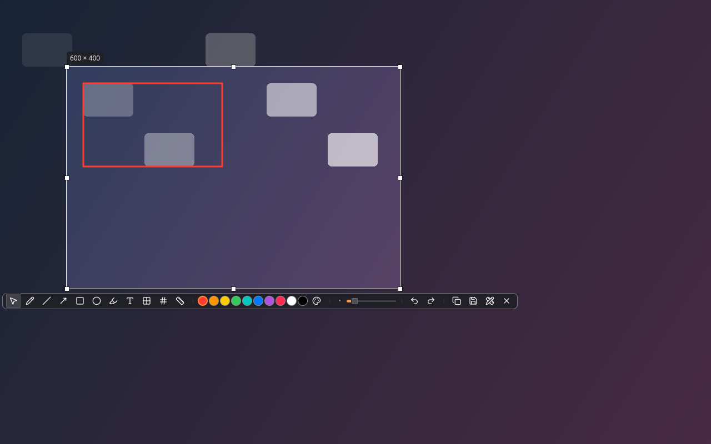
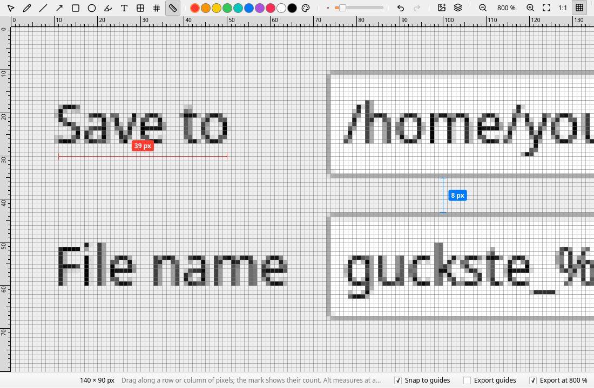

<p align="center">
  
</p>

<h1 align="center">Guckste</h1>

A screenshot and screen recording tool for the tray, written with Qt
Quick. It works like flameshot: a click on the tray icon or `guckste gui`
freezes the screen, you pick a region, a window or a screen, draw on it,
and copy or save it. On top of that it has an editor that enlarges a
screenshot pixel for pixel, puts measurement marks on it that count the
pixels, combines several screenshots into one picture with a layer panel
and GIMP-style guides, and keeps every mark editable. The same picker
starts a recording, which opens in the same editor: there it is trimmed
and drawn on, each mark showing for a time of its own, set on lanes
under the timeline; further videos go beside it or after it, and any
frame can be taken out as an image.


## Download

Every night with new commits, the
[nightly release](https://github.com/iam-peter/guckste/releases/tag/nightly)
is rebuilt for Linux (an AppImage), Windows and macOS. The macOS app isn't
signed: open it with a right click and Open the first time, and allow it to
record the screen when macOS asks.

On Debian and Ubuntu, Guckste can come from its APT repository instead,
which brings its own Qt:

```bash
sudo curl -fsSLo /usr/share/keyrings/guckste-archive-keyring.asc https://iam-peter.github.io/guckste/key.asc
echo "deb [signed-by=/usr/share/keyrings/guckste-archive-keyring.asc] https://iam-peter.github.io/guckste/apt stable main" | sudo tee /etc/apt/sources.list.d/guckste.list
sudo apt update && sudo apt install guckste
```

Put `nightly` in place of `stable` for the nightly builds.

## Using it

`guckste` starts in the tray. The tray menu takes a screenshot, opens an
image in the editor, records the screen, switches launching at login on
and off, and opens the settings. There is
one Guckste per user: it holds a lock file, and started again, `guckste`
hands its command to the running instance and quits (`guckste --replace`
quits the running one and takes its place, for a new build):

- `guckste gui` — pick a region. Bind it to Print in your desktop's
  keyboard settings (XFCE: Settings → Keyboard → Application Shortcuts;
  GNOME: Settings → Keyboard → Custom Shortcuts; KDE: System Settings →
  Shortcuts).
- `guckste full` — all screens to the clipboard and the screenshot folder,
  without asking.
- `guckste record` — pick a region to record, or stop the recording that
  is running. Bound to a key, one key starts and stops.
- `guckste open [file]` — the editor, with a file dialog when no file is
  given.
- `guckste settings`, `guckste quit`.

### Picking a region



The screen is dimmed and a crosshair follows the pointer with its
coordinates. A bar at the top of the screen the pointer is on, which
follows it from screen to screen, picks the way:
**Region** (3) is for dragging one out; **Window** (2) outlines the
window under the pointer, frame included, and a click takes it;
**Screen** (1) does the same with the screen; **All screens** (4)
selects everything at once; and **Previous** (5) selects the region of
last time, drawn dashed in the other modes, so the same part of the
screen can be captured or recorded over and over. A drag picks a region
in any mode, switching the mode drops the region picked so far, and the
mode is kept for the next time, so All screens and Previous have their
region selected as soon as the overlay opens. Ctrl+A selects everything
in any mode. The region can be dragged, resized by its handles and
nudged with the arrow keys (Shift for 10 px). A toolbar appears under
it:

- Tools: select (V), pen (P), line (L), arrow (A), rectangle (R), ellipse
  (O), marker (M), text (T), pixelate (X), numbered marker (N), measure (D).
  Shift snaps lines to 45° and keeps rectangles square.
- Ten colors and any other, and a size slider for strokes and markers.
  With the text tool, or a text selected, it becomes the text's size in
  pixels, to type in or step through. With a mark selected, the color and
  the size go to it, here as in both editors, and selecting one shows
  its own.
- Undo and redo (Ctrl+Z, Ctrl+Shift+Z). With the select tool, click a mark
  to move it; Delete removes it. Right-click drops the mark being drawn,
  then the selection of a mark, then the region, then the overlay.
- Enter or Ctrl+C copies the region to the clipboard, Ctrl+S saves it to
  the screenshot folder, E opens it in the editor, Shift+Enter records it,
  Esc cancels.
- The timer button captures the region again after 3, 5 or 10 seconds:
  the overlay goes away, a countdown shows beside the region, and the
  overlay comes back with the region selected and whatever was opened
  meanwhile, a menu or a tooltip, in the shot.

### Recording

Shift+Enter, the camera button, `guckste record` or the tray's Record
Screen… record the region to a video. A red frame marks the region and a
small panel outside it shows the time, with pause and stop; the panel can
be dragged anywhere. Neither is in the recording. When a whole screen is
recorded there is no panel: the tray menu's Stop Recording or `guckste
record` ends it. A pause cuts the time out of the video; there is none
while the microphone is recorded, whose sound would not follow the cut.

The panel says "Starting…" for the first 1.5 seconds, which are left out:
windows the overlay covered, like a browser playing a video, stop drawing
meanwhile and take a moment to draw again, and would otherwise open the
video with a frozen picture. The microphone starts with the video, so the
sound stays with the picture.

The pointer is in screenshots and recordings unless the settings say
otherwise: the real cursor image on X11 (XFixes), Windows and macOS,
and an arrow standing in for it on Wayland. The settings can also show
the keys pressed while recording as chips along the bottom of the video,
`Ctrl+Shift+S` and the like, each for a few seconds, and in the panel:
from XInput2 on X11, a keyboard hook on Windows, an event tap on macOS,
which asks for the Accessibility permission. Wayland has no way to
listen, so the option is not offered there. Every key on the desktop is
seen while that is on, so leave it off when typing a password.

Stopping opens the recording in the editor (the settings can send it
straight to the screenshot folder instead), as a clip on the canvas,
locked like a screenshot until it is unlocked in the layer panel. With a
video in it the editor has a timeline below the canvas. The same tools
draw on the video, at the size they will have in the file. Space plays
and pauses, `,` and `.` step a frame, `[` and `]` set the start and the
end to keep, which the handles on the timeline do as well; click or drag
the timeline to scrub.

More videos come in from the add button or by dropping them on the
window: "Video after the others" places one where the last clip is,
starting when it ends, so they play one after the other; "Video beside"
places one right of the canvas from the start, so they play side by
side. Screenshots and images go in as before, shown the whole time. A
clip moves and resizes on the canvas like an image.

Every layer gets a lane under the timeline, as in a video editor: a bar
for when it shows. A clip's bar is as long as its video at most:
dragging its start trims the beginning of the video, its end the end. A new mark starts at the playhead and lasts to the
end; drag the bar's edges to set when it comes and goes, or the bar to
move it in time. Click a lane to select its mark (going to where it
shows if it is not there at the playhead), double-click to go to its
start, and right-click to show or hide it from the playhead, show it the
whole time, or remove it. Ctrl-click and Shift-click select several
lanes: dragged, they move together, and an edge stretches all of them;
the right-click actions go to all of them too. The lanes scroll, and the
divider above the controls makes room for more of them. A pixelated
area coarsens the frame on screen, as it will in the saved video.

Save (Ctrl+S) writes the video to the screenshot folder: every frame is
the canvas at its time, each clip at its frame, the marks and images in
their order, the clips' sound mixed, the trimmed parts left out. A
recording saved as it is, one clip, untrimmed and unmarked, is moved
there instead. Closing without saving deletes the recording. The camera
button (Ctrl+Shift+F) opens the frame on screen in a new editor, each
clip as an image of that frame and every mark still editable, to save as
a picture; Copy copies the frame. `guckste open talk.mp4`, or Open in
the editor, opens an existing video the same way; that file is left
alone and the result is a new one.

Recording goes through Qt Multimedia and the FFmpeg that comes with Qt, so
nothing has to be installed. The format is the first of MP4/H.264,
WebM/VP9, WebM/VP8, MP4/MPEG-4, MKV/MPEG-4 and AVI/MJPEG that encodes on
the machine, found out by encoding a few frames the first time: Qt's
FFmpeg has H.264 only through VAAPI or NVENC hardware, and where that is
missing the file is MP4 with MPEG-4 part 2. Frames are handed to Qt as
NV12, since from RGB frames Qt may pick a 12-bit format for NVENC that it
refuses. The settings have the frame rate, a quality level that sets the
bit rate from the region's size (low to very high: 1, 2, 4 or 8 bits per
pixel and frame at 30 fps, so 1080p at high is about 8 Mbit/s), and
whether the microphone is recorded.

On X11 the region may span screens (Qt captures the whole desktop there).
Elsewhere it is clipped to the screen under its center.

### The editor

The editor shows a screenshot at any zoom from 25 % to 3200 %, each pixel
a crisp block from 100 % up and a grid between them from 800 % (G toggles
it). Ctrl+wheel zooms at the pointer, the wheel scrolls, the middle button
or Space drags the view, Ctrl+0 fits, Ctrl+1 is 100 %. The status bar
shows the pixel under the pointer, its color and the canvas size. In a
narrow window, what does not fit on the toolbar moves behind a » button
at its end.

The same tools draw on it, and marks are part of the image: sizes are in
image pixels, so a 3 px pen and a 20 px text grow with the screenshot
when zooming in, as in any image editor. Measure marks are the
exception: their line and label keep their size on screen, so they stay
readable at 800 % and beyond. The measure tool drags a line along a row
or column of pixels and labels it with their count; the ends snap to
pixel edges, so a drag from the left edge of one pixel to the right edge
of another counts both. Alt measures at any angle, with the rounded
length marked ≈.



Marks stay editable. With the select tool (V), click a mark to select it
and drag it to move it. Lines, arrows and measurements have a handle on
each end; rectangles, ellipses, markers and pixelated areas have handles
on their corners and edges (Shift keeps them square, or snaps a line to
45°). Double-click a text to retype it where it is. The color and size
on the toolbar go to the selected mark. Delete removes it.

The screenshot is the bottom layer, locked so clicks and drags go to the
marks; the lock in its row of the layer panel unlocks it, to move,
resize, raise or remove it like any other image. Any layer can be locked
the same way.

Further screenshots and images can be combined with the first one: the
add button captures a region (the editor steps aside meanwhile, and Enter
in the overlay adds the region), opens image files, or pastes the
clipboard (Ctrl+V); images can also be dropped on the window. Each one
lands right of what is there and can be moved and resized like a mark,
keeping its shape from a corner unless Shift is held. The canvas grows to
take in all of them, and what no image covers stays transparent in the
export.

Rulers along the top and left count image pixels and mark where the
pointer is. Drag out of one to place a guide, as in GIMP: from the top a
horizontal one, from the left a vertical one. With the select tool a
guide can be dragged again, and dropped back on a ruler it goes;
right-clicking a ruler removes them all. With "Snap to guides" in the
status bar, what is drawn, moved or resized lines up with a guide once
within a few pixels of it, edges and middles alike. "Export guides" draws
them into copies and saved images, 1 px wide at any zoom.

The layer panel on the right lists every mark, image and clip, topmost
first: click one to select it, lock or unlock it, raise or lower it with
the arrows, or remove it. Double-clicking a text there edits it too.

Copy and save export what is on screen: the canvas enlarged pixel for
pixel at the current zoom, with the marks enlarged along. Untick "Export
at … %" in the status bar to export at the image's own size instead.
Save (Ctrl+S) writes back to an image that was opened from a file when
exporting at 100 %, otherwise it asks for a name; Save as…
(Ctrl+Shift+S) always asks.

### Settings

- The screenshot folder (Pictures/Screenshots by default) and the file
  name pattern (`guckste_%Y-%m-%d_%H-%M-%S`, with strftime's `%Y %m %d %H
  %M %S %b %a`; a number is appended when the name is taken; recordings
  use it too).
- Whether the pointer is in screenshots and recordings, and whether the
  keys pressed are shown on recordings.
- Whether a saved file's path goes to the clipboard, and the editor's
  pixel grid from 800 %.
- Recording: the frame rate (15, 24, 30 or 60 fps), the quality, the
  microphone, and whether a recording opens in the editor or goes
  straight to the screenshot folder.
- Launching at login, which writes `~/.config/autostart/guckste.desktop`
  on Linux.

The picker remembers its mode, the last region, the color and the sizes;
the editor remembers snapping to guides and exporting them.

## Building

Requires Qt ≥ 6.9 with Qt Multimedia, and CMake ≥ 3.21. On Linux QtDBus
is used, if found, to ask the desktop portal for screenshots on Wayland,
and the X11 libraries Xfixes, Xi and Xext (libxfixes-dev, libxi-dev,
libxext-dev) for the pointer image, the keys pressed and grabbing the
screen through shared memory, which opens the picker several times
faster than Qt's own grab.

```bash
cmake -B build -G Ninja -DCMAKE_PREFIX_PATH=$HOME/Qt/6.12.0/gcc_64
cmake --build build
ctest --test-dir build --output-on-failure
./build/bin/guckste
```

For daily use, build with `-DCMAKE_BUILD_TYPE=Release`; a debug build is
noticeably slower to open the picker and to grab the screen.

`cmake --install build` also installs a desktop file with a launcher action
for each command, and the icon. `tst_ui` saves screenshots of the windows
when `GUCKSTE_SCREENSHOT_DIR` is set, and stages the screenshots of this
README and the site on a made-up desktop into the folder
`GUCKSTE_SITE_SHOTS` names (`docs/screenshots`). `tst_recorder` records the
screen for a few seconds to the file `GUCKSTE_LIVE_RECORD` names. To try a
build next to the Guckste in use, give it its own instance name:
`GUCKSTE_INSTANCE=dev ./build/bin/guckste`.

## Layout

- `src/core` — no Qt Quick dependency: `Annotation` (one mark or added
  image, its geometry and sizes in image pixels, and its time on a
  recording), `AnnotationPainter` (draws marks with a QPainter at any
  scale, the same way on screen and into the export), `Document` (the
  image, its marks and guides, undo, the canvas, handles, rendering and
  saving), `LayerModel` (a document's marks as a list, for the layer
  panel and the lanes), `ScreenCapture` (every screen through Qt, the X
  root window through shared memory, or the desktop portal on Wayland),
  `WindowFinder` (the windows on screen, for picking one), `CursorCapture`
  and `KeyListener` with `KeyOverlay` (the pointer and the keys pressed,
  per platform), `ScreenRecorder` (QScreenCapture frames cropped to the
  region and encoded by QMediaRecorder), `Playback` (a clock for the
  document's time, with a player per clip that follows it),
  `VideoExporter` (decodes the clips as their time comes and puts every
  frame together from them and the marks, mixing their sound, into a
  recorder), `VideoProbe` (a video's size, length and first frame),
  `Encoding` and `VideoFrames` (the format this Qt
  encodes, bit rates, frames as NV12), `SingleInstance` (one Guckste per
  user, by a lock file and a local socket), `Preferences` and
  `FileNaming`.
- `src/ui` — `AnnotationLayer`, the item that paints a document's marks
  over the image at the view's zoom, sized to the viewport rather than the
  image; `Ruler`, the editor's rulers; `App`, the tray icon and the
  windows; the image provider that shows documents to QML.
- `src/qml` — `CaptureOverlay`, `EditorWindow` with its `LayerPanel`,
  and with video the `Timeline` and its `TimelineLanes`,
  `SettingsWindow`, `RecordingControls`, the timer's `Countdown`, and what
  the windows share: the `AnnotationToolbar` with its `ColorPicker`, and
  the `DrawingArea` with the pointer handling of every tool, the handles,
  the guides and the `TextEntry` (QML module `Guckste`).

Platforms: X11 is where it is used and tested. On Wayland the screenshot
comes from the desktop portal and the overlay covers the screen it is put
on; several screens at once are not supported there yet, recording needs
Qt's Wayland screen capture, and there is no window picking, cursor image
or key listening. Windows and macOS build in CI and capture through Qt,
with their own cursor, key and window code, but have had less testing.

## Ideas

- Recording to GIF.
- A magnifier while picking the region.
- Pinning a screenshot to the screen.

## Third-party assets

- Icons: [Lucide](https://lucide.dev), ISC license (`src/icons/LICENSE.txt`).

## License

Guckste is released under the MIT license; see `LICENSE`. The icons keep
their own license.
